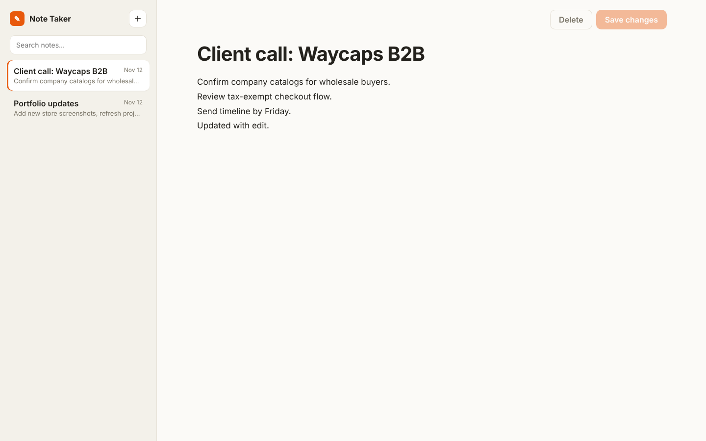

# Note Taker

Write, edit and organize notes in a clean two-pane editor. Notes are stored by a small Express REST API backed by a JSON file.



## Features

- Create, edit and delete notes
- Instant search across titles and note text
- Notes sorted by last edit, with dates
- Save button only enables when there are unsaved changes; Ctrl/⌘ + S to save
- Input validation and error handling on the API
- Responsive layout

## API

| Method | Route            | Description        |
| ------ | ---------------- | ------------------ |
| GET    | `/api/notes`     | List all notes     |
| POST   | `/api/notes`     | Create a note      |
| PUT    | `/api/notes/:id` | Update a note      |
| DELETE | `/api/notes/:id` | Delete a note      |

## Built with

Node.js, Express, vanilla JavaScript, HTML and CSS.

## Run locally

```bash
npm install
npm start
```

Then open http://localhost:3001.
